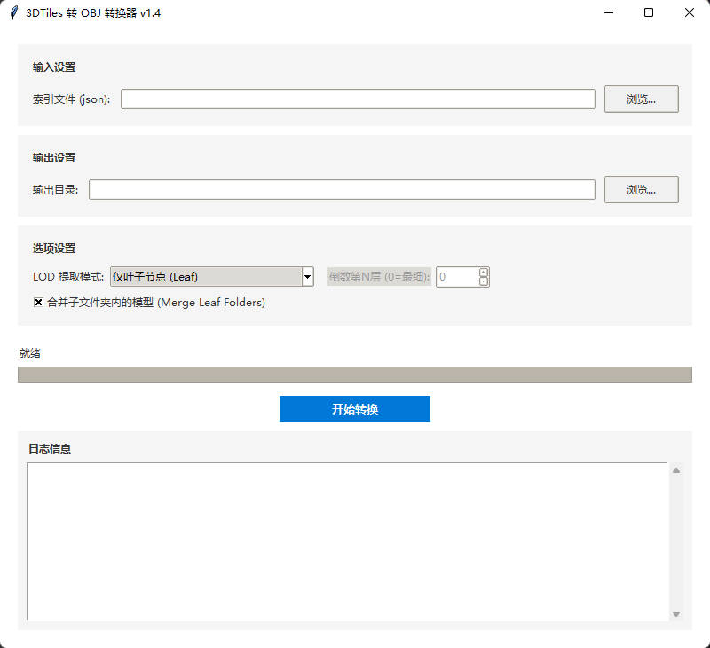

# ObjOrthoRender

把带纹理的 **3D OBJ 模型** 渲染成 **带地理参考的 GeoTIFF 正射影像（DOM）**，支持批量处理、多进程加速与多级合并输出。

> English: Render textured OBJ models into georeferenced GeoTIFF orthophotos. Batch processing, multiprocessing, three merge strategies, and a Tkinter GUI. Runs headless in Docker via Xvfb + Mesa software OpenGL.

在倾斜摄影 / 实景三维的生产链路里，模型通常是「3D Tiles → OBJ」的产物，而后续的制图、变化检测、建筑物提取都需要 2D 正射影像。这一步往往只能靠商业软件完成——本项目就是把这个环节做成可脚本化、可容器化的开源工具。



## 目录

- [功能特点](#功能特点)
- [环境要求](#环境要求)
- [安装](#安装)
- [使用方法](#使用方法)
  - [图形界面](#1-图形界面-gui)
  - [命令行](#2-命令行-cli)
  - [Docker](#3-docker-无显卡也可运行)
  - [打包为 EXE](#4-打包为-windows-exe)
- [输入数据格式](#输入数据格式)
- [输出结果](#输出结果)
- [渲染质量与性能](#渲染质量与性能)
- [常见问题](#常见问题)
- [更新日志](#更新日志)
- [许可](#许可)

## 功能特点

- **正射投影渲染**：沿 Z 轴正交投影，逐块渲染大模型，直接写入 GeoTIFF。
- **地理参考**：读取 `metadata.xml` 中的 `SRS` 与 `SRSOrigin`，为输出影像写入坐标系与原点。
- **多级合并**：`none`（不合并）/ `subfolder`（按子目录合并）/ `all`（全部合并），合并优先调用 `osgeo.gdal`。
- **填洞后处理**：`--fill-holes off|on|fast|strong`，主要用于修补水面、遮挡导致的孔洞。
- **多进程加速**：按 OBJ 文件并行，显存/内存不足时可通过 `--workers` 收敛。
- **分块渲染**：单个超大模型内部再切 tile，避免 OpenGL 纹理尺寸与显存上限。
- **无显示环境可用**：Docker 镜像内置 `Xvfb + Mesa`，服务器无需独显也能跑（慢于 GPU）。
- **中文 GUI**：Tkinter 界面，路径选择 + 参数配置 + 实时日志。

## 环境要求

| 项目 | 要求 |
| :--- | :--- |
| 操作系统 | Windows / Linux / macOS |
| Python | 3.8+ |
| GPU | 非必需。有 OpenGL 3.3+ 的显卡会快很多；纯 CPU 走 Mesa 软件渲染亦可 |
| GDAL | Linux 下建议单独装 `gdal-bin libgdal-dev`（合并阶段用 `osgeo.gdal` 更快） |

## 安装

```bash
git clone https://github.com/UVE1048/ObjOrthoRender.git
cd ObjOrthoRender
pip install -r requirements.txt
```

依赖说明：

- `trimesh` / `pyrender` / `pyglet` — 网格加载与 OpenGL 离屏渲染
- `rasterio` — GeoTIFF 写入与合并
- `scipy` — 填洞用的形态学与连通域运算
- `pyfastobj`（仅 Windows）— 更快的 OBJ 解析
- `GDAL==3.6.2`（仅 Linux）— 合并加速

## 使用方法

### 1. 图形界面 (GUI)

```bash
python gui_app.py
```

界面中需要填三项路径：

- **输入文件夹**：包含 OBJ 的目录（会递归查找子目录里的 `.obj`）
- **metadata.xml（可选）**：留空则自动用 `<输入文件夹>/metadata.xml`
- **输出文件夹**：结果保存位置（GUI 模式不会默认写到 `MergedDOM`）

其余参数（GSD、线程数、合并模式）按需调整，点「开始处理」，下方日志窗口实时输出进度。

### 2. 命令行 (CLI)

```bash
python render_orthophotos.py \
  --input  path/to/input \
  --output path/to/output \
  --gsd 0.05 \
  --workers 4 \
  --merge-mode all
```

| 参数 | 默认值 | 说明 |
| :--- | :--- | :--- |
| `--input` | 必填 | 输入目录，递归查找 `.obj` |
| `--output` | `<input>/MergedDOM` | 输出目录 |
| `--metadata` | `<input>/metadata.xml` | 可选，指定任意路径的 metadata.xml |
| `--gsd` | `0.05` | 地面采样距离，米/像素 |
| `--workers` | CPU 核数 | 并行进程数 |
| `--merge-mode` | `all` | `all` / `subfolder` / `none` |
| `--fill-holes` | `on` | `off` / `on` / `fast` / `strong` |
| `--subdir` | 无 | 只处理指定子目录，可重复指定多次 |

### 3. Docker（无显卡也可运行）

镜像基于 `python:3.10-slim-bookworm`，内含 `Xvfb` + `Mesa` 软件 OpenGL，无显示器的服务器可直接使用。

```bash
docker build -t obj-ortho-cli:1.0.3 .
docker run --rm -it -v /host/input:/data obj-ortho-cli:1.0.3
```

容器内默认输入为 `/data`，输出写入 `/data/MergedDOM`。常用组合：

```bash
# 提高并行度 + 按子目录合并
docker run --rm -it -v /host/input:/data obj-ortho-cli:1.0.3 --workers 8 --merge-mode subfolder

# 指定挂载目录下的子目录与 metadata
docker run --rm -it -v /host/root:/data obj-ortho-cli:1.0.3 \
  --input /data/projectA/Mesh --metadata /data/projectA/metadata.xml

# 关闭填洞 / 强化填洞
docker run --rm -it -v /host/input:/data obj-ortho-cli:1.0.3 --fill-holes off
docker run --rm -it -v /host/input:/data obj-ortho-cli:1.0.3 --fill-holes strong
```

如需离线分发，可导出镜像：

```bash
docker save -o obj-ortho-cli_1.0.3.tar obj-ortho-cli:1.0.3
# 目标机器
docker load -i obj-ortho-cli_1.0.3.tar
```

> 更细的 Docker / GUI 参数说明见 [`docs/usage.md`](docs/usage.md)。

### 4. 打包为 Windows EXE

```bash
python build_exe.py
```

产物位于 `dist/ObjOrthoRender/`。打包脚本会自动处理 `pyproj` 的 PROJ 数据目录、`GDAL` 与 `Pillow` 的隐藏导入，并把 `proj.db` 一并打进去——这解决了一个很常见的坑：目标机器上装了旧版 PROJ 时，`EPSG:3857` 会报 unknown。

## 输入数据格式

输入目录需包含：

**1. `metadata.xml`** — 定义坐标系与模型原点

```xml
<Metadata>
    <SRS>EPSG:3857</SRS>
    <SRSOrigin>0,0,0</SRSOrigin>
</Metadata>
```

`SRSOrigin` 是模型局部坐标 (0,0,0) 对应的真实地理坐标，务必与模型生成时一致，否则整体会偏移。

**2. OBJ 模型与纹理**

- `.obj` 可位于任意子目录（如 `Tile_+001_+001/model.obj`）
- `.mtl` 与贴图需能被 OBJ/MTL 里的相对路径正确解析

## 输出结果

```text
<output>/
├── <保持与输入一致的目录结构>/*.tif   # 逐块渲染结果（merge-mode=none 时保留）
└── MergedDOM/
    ├── merged_all.tif                # merge-mode=all
    └── merged_<子目录名>.tif          # merge-mode=subfolder
```

输出为 **RGB 三波段**，无 alpha 通道，模型空白区域为黑色——这样在 QGIS / ArcGIS 里不会出现透明叠加导致的边界异常。

## 渲染质量与性能

- **背景处理**：反预乘去黑边 + mask 阈值，避免纹理边缘出现一圈半透明黑边。
- **光照**：大幅提高环境光强度并加一盏平行光，消除自遮挡阴影，尽量还原纹理本色。
- **大模型稳定性**：模型内部再切 tile 逐块渲染并直接写 GeoTIFF，绕开单张纹理尺寸与显存限制。
- **纹理保真**：超大贴图下自动选择合适的 mipmap 级别，在质量与耗时之间取平衡。
- **填洞**：按连通域面积分流，小洞快速闭运算，大洞（水面）用更多迭代次数。

## 常见问题

**Q：模型在地图上位置整体偏移？**
检查 `metadata.xml` 的 `SRSOrigin` 是否与出模时一致；再确认 `SRS` 是 `EPSG:3857` 而不是 `EPSG:4326`。

**Q：输出一片纯黑？**
多数是 OpenGL 没起来。Docker 下确认 `DISPLAY=:99` 与 `Xvfb` 正常；本机跑先试 `glxinfo | grep OpenGL`。

**Q：合并阶段吃满内存？**
`--merge-mode all` 会把全部影像并成一个巨型 TIFF。范围大时改用 `--merge-mode subfolder`，或分批传入 `--subdir`。

**Q：Windows 下 `pip install GDAL` 失败？**
`requirements.txt` 里 GDAL 只在 Linux 生效。Windows 用 `conda install -c conda-forge gdal` 更省事。

## 项目结构

```text
.
├── render_orthophotos.py   # 渲染核心 + CLI 入口
├── gui_app.py              # Tkinter GUI
├── build_exe.py            # PyInstaller 打包脚本
├── release_build.py        # 发布构建流程
├── Dockerfile              # 无头运行镜像（Xvfb + Mesa）
├── requirements.txt
├── docs/
│   └── usage.md            # Docker / GUI 详细参数说明
└── assets/
    └── gui.jpg
```

## 更新日志

### v1.0.3
- 新增 `--fill-holes`（`off/on/fast/strong`），默认开启，用于基于 mask 的孔洞后处理（主要针对水面）

### v1.0.2
- 去黑边处理（反预乘）+ mask 阈值
- Windows EXE 打包改为 onedir，降低启动与运行开销
- GUI 默认 workers 调整为 4

### v1.0.1
- 新增 `--metadata`，可使用任意路径的 metadata.xml
- CLI 进度条更稳定，增加计时与 Summary 汇总

### v1.0.0
- 新增 Docker CLI 版本（默认只挂载输入目录，输出写入 `MergedDOM`）
- 合并模式统一为 `--merge-mode`（`all/subfolder/none`），默认 `all`
- 默认合并后清理单张 TIFF，仅保留合并结果
- 合并阶段优先使用 `osgeo.gdal`，提升合并性能

## 许可

[MIT](LICENSE)
