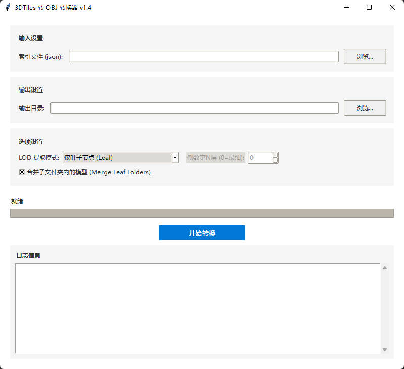

> 此文件用于 PyPI 页面渲染（相对图片路径已替换为绝对 URL）。仓库内的正式 README 是 [README.md](https://github.com/UVE1048/ObjOrthoRender)。

# ObjOrthoRender

[](LICENSE)
[](https://www.python.org/)
[](https://github.com/UVE1048/ObjOrthoRender/stargazers)
[](https://github.com/UVE1048/ObjOrthoRender/commits/main)
[](https://github.com/UVE1048/ObjOrthoRender/actions/workflows/ci.yml)

**把带纹理的 OBJ 三维模型批量渲染成带地理参考的 GeoTIFF 正射影像（DOM）。**

Render textured OBJ meshes into georeferenced GeoTIFF orthophotos — batch processing, multiprocessing, multi-level merging, headless Docker support.

---

**也叫**：正射影像生成工具 · OBJ 转 DOM · 模型转正射影像 · 倾斜摄影导出正射 · 三维模型出正射图 · orthophoto generator · mesh to orthophoto · OBJ2DOM

**什么时候该用**：你有一批带纹理的 OBJ 模型和配套 `metadata.xml`，需要批量产出带坐标系的正射影像。
**什么时候不该用**：只有 2D 影像要做配准（用 GDAL / rasterio）；需要从照片做三维重建（用 Metashape、OpenDroneMap）。

## 这是什么

在倾斜摄影 / 实景三维的生产链里，模型通常是「3D Tiles → OBJ」的产物，而后续制图、变化检测、建筑物提取都需要 **2D 正射影像**。这一步长期只能靠商业软件点鼠标。

这个项目把它做成可脚本化、可容器化的命令行工具：给定一批 OBJ 和一份 `metadata.xml`，输出带坐标系与原点的 GeoTIFF，能直接进 QGIS / ArcGIS / GDAL 流水线。

**关键词**：正射影像 · 数字正射影像图 · DOM · OBJ 转 DOM · 三维模型转二维 · 倾斜摄影 · 实景三维 · 摄影测量 · GeoTIFF · EPSG:3857 · Web Mercator · 分块渲染 · OpenGL 离屏渲染 · 无显卡服务器
**Keywords**: orthophoto · orthomosaic · DOM · OBJ to GeoTIFF · photogrammetry · 3D Tiles · mesh rendering · pyrender · trimesh · rasterio · GDAL · headless OpenGL · Xvfb



## 特性

| 能力 | 说明 |
| :--- | :--- |
| 正射投影渲染 | 沿 Z 轴正交投影，逐块渲染大模型并直接写入 GeoTIFF |
| 地理参考 | 读取 `metadata.xml` 的 `SRS` + `SRSOrigin`，写入坐标系与原点 |
| 三级合并 | `none` 不合并 / `subfolder` 按目录合并 / `all` 全局合并，合并优先走 `osgeo.gdal` |
| 填洞后处理 | `--fill-holes off\|on\|fast\|strong`，按连通域面积分流，主要修补水面与遮挡孔洞 |
| 多进程加速 | 按 OBJ 文件并行，`--workers` 可控 |
| 分块渲染 | 单个超大模型内部再切 tile，绕开显存与纹理尺寸上限 |
| 无显卡运行 | Docker 镜像内置 Xvfb + Mesa 软件 OpenGL，服务器无需独显 |
| 中文 GUI | Tkinter 界面：路径选择、参数配置、实时日志 |

## 快速开始

```bash
git clone https://github.com/UVE1048/ObjOrthoRender.git
cd ObjOrthoRender
pip install -r requirements.txt
```

### 先用样例数据跑通（约 60 秒）

仓库自带一份**合成样例**（3 个盒子 + 地面，带棋盘贴图，不含任何真实地理数据），不需要准备自己的模型：

```bash
python render_orthophotos.py --input examples/sample --output out --gsd 0.5
```

跑完在 `out/merged_all.tif` 得到一个带地理参考的正射影像：240×240 像素、GSD 0.5 m，即 120 m 见方，`EPSG:3857`，原点 `0,0`。拖进 QGIS 就能定位。

棋盘格贴图会显示出每个面的边界，方便确认 UV 方向是否正确。

> 如果你在这台机器上看到 `[WARN] Textured rendering failed`，说明贴图上传失败、程序回退成了白色材质（几何与地理参考仍然正确，只是没有纹理）。原因与处理见[常见问题](#常见问题)。

### 图形界面

```bash
python gui_app.py
```

### 处理自己的模型

```bash
python render_orthophotos.py \
  --input  path/to/input \
  --output path/to/output \
  --gsd 0.05 \
  --workers 4 \
  --merge-mode all
```

### Docker（无显卡服务器可直接用）

```bash
docker build -t obj-ortho-cli:1.0.3 .
docker run --rm -it -v /host/input:/data obj-ortho-cli:1.0.3
```

## 输入格式

**1. `metadata.xml`** — 定义坐标系与模型原点

```xml
<Metadata>
    <SRS>EPSG:3857</SRS>
    <SRSOrigin>0,0,0</SRSOrigin>
</Metadata>
```

`SRSOrigin` 是模型局部坐标 `(0,0,0)` 对应的真实地理坐标，必须与出模时一致，否则整体偏移。

**2. OBJ 模型与纹理**

- `.obj` 可位于任意子目录（如 `Tile_+001_+001/model.obj`）
- `.mtl` 与贴图需能被 OBJ/MTL 里的相对路径正确解析

## 参数

| 参数 | 默认值 | 说明 |
| :--- | :--- | :--- |
| `--input` | 必填 | 输入目录，递归查找 `.obj` |
| `--output` | `<input>/MergedDOM` | 输出目录 |
| `--metadata` | `<input>/metadata.xml` | 可选，指定任意路径 |
| `--gsd` | `0.05` | 地面采样距离（米/像素） |
| `--workers` | CPU 核数 | 并行进程数 |
| `--merge-mode` | `all` | `all` / `subfolder` / `none` |
| `--fill-holes` | `on` | `off` / `on` / `fast` / `strong` |
| `--subdir` | 无 | 只处理指定子目录，可重复指定 |

## 输出

```text
<output>/
├── <与输入一致的目录结构>/*.tif    # 逐块结果（merge-mode=none 时保留）
└── MergedDOM/
    ├── merged_all.tif             # merge-mode=all
    └── merged_<子目录名>.tif       # merge-mode=subfolder
```

输出为 **RGB 三波段**，无 alpha 通道，空白区域为黑色 —— 这样在 QGIS / ArcGIS 里不会出现透明叠加导致的边界异常。

## 与替代方案对比

| 方案 | 批量/脚本化 | 坐标系自动写入 | 无显卡服务器 | 成本 |
| :--- | :--- | :--- | :--- | :--- |
| **ObjOrthoRender** | 命令行 + 配置文件 | ✅ 读 metadata.xml | ✅ 内置 Xvfb + Mesa | 免费 MIT |
| 商业三维软件导出正射 | 依赖 GUI 操作 | 通常需手工设置 | ❌ | 授权费高 |
| Blender 渲染 + 手工配准 | 需自己写脚本 | ❌ 需另行配准 | 部分可行 | 免费但工作量大 |
| GDAL 栅格化 | 只处理 2D | ✅ | ✅ | 丢失纹理 |

关键差别在第三列：本项目的 Docker 镜像自带软件 OpenGL，**在没有任何 GPU 的服务器上也能跑**，这对批量生产环境是刚需。

## 渲染质量与性能

- **去黑边**：反预乘 + mask 阈值，消除纹理边缘的半透明黑边
- **光照**：提高环境光强度并加一盏平行光，消除自遮挡阴影，尽量还原纹理本色
- **大模型稳定性**：模型内部切 tile 逐块渲染并直接写 GeoTIFF
- **纹理保真**：超大贴图下自动选择 mipmap 级别，平衡质量与耗时
- **填洞**：小洞走快速闭运算，大洞（水面）用更多迭代次数

## 常见问题

**Q：输出全白，日志里有 `[WARN] Textured rendering failed`？**
贴图上传失败了，程序回退成白色材质——几何、坐标、尺寸都是对的，只是没有纹理。这是 pyrender / PyOpenGL 的兼容问题，多见于 macOS + Python 3.13（`glGenTextures` 抛 `ctypes.ArgumentError`）。
处理办法：换 Python 3.12，或直接用 Docker 镜像（内置 Xvfb + Mesa）。程序一定会打印这条警告，不会静默产出白图。

**Q：模型在地图上整体偏移？**
检查 `metadata.xml` 的 `SRSOrigin` 是否与出模时一致；再确认 `SRS` 是 `EPSG:3857` 而非 `EPSG:4326`。

**Q：输出一片纯黑？**
多数是 OpenGL 没起来。Docker 下确认 `DISPLAY=:99` 与 Xvfb 正常；本机跑先试 `glxinfo | grep OpenGL`。

**Q：合并阶段吃满内存？**
`--merge-mode all` 会把全部影像并成一张巨型 TIFF。范围大时改 `--merge-mode subfolder`，或用 `--subdir` 分批。

**Q：Windows 下 `pip install GDAL` 失败？**
`requirements.txt` 里 GDAL 只在 Linux 生效。Windows 建议 `conda install -c conda-forge gdal`。

## 项目结构

```text
.
├── render_orthophotos.py   # 渲染核心 + CLI 入口
├── gui_app.py              # Tkinter GUI
├── build_exe.py            # PyInstaller 打包
├── release_build.py        # 发布构建流程
├── Dockerfile              # 无头运行镜像
├── docs/usage.md           # Docker / GUI 详细参数
└── assets/gui.jpg
```

## 更新日志

### v1.0.3
- 新增 `--fill-holes`（`off/on/fast/strong`），默认开启，基于 mask 的孔洞后处理（主要针对水面）

### v1.0.2
- 去黑边处理（反预乘）+ mask 阈值
- Windows EXE 打包改为 onedir，降低启动与运行开销
- GUI 默认 workers 调整为 4

### v1.0.1
- 新增 `--metadata`，支持任意路径的 metadata.xml
- CLI 进度条更稳定，增加计时与 Summary

### v1.0.0
- 新增 Docker CLI 版本
- 合并模式统一为 `--merge-mode`（`all/subfolder/none`）
- 合并阶段优先使用 `osgeo.gdal`

## 引用

如果这个项目对你的工作有帮助，可以这样引用：

```bibtex
@software{objorthorender2026,
  title  = {ObjOrthoRender: Render textured OBJ meshes into georeferenced GeoTIFF orthophotos},
  author = {UVE},
  year   = {2026},
  url    = {https://github.com/UVE1048/ObjOrthoRender}
}
```

## 相关项目

同一套实景三维链路上的其他工具：

- [ObjOrthoRender](https://github.com/UVE1048/ObjOrthoRender)：OBJ 模型转带地理参考的 GeoTIFF 正射影像 ←
- [Footprint-Creater](https://github.com/UVE1048/Footprint-Creater)：正射影像建筑物轮廓提取，输出 Shapefile
- [HRNet-Footprint-Trainer](https://github.com/UVE1048/HRNet-Footprint-Trainer)：建筑物分割模型训练：切片、训练、大图推理
- [VideoFusion-Web](https://github.com/UVE1048/VideoFusion-Web)：无人机视频融合投射到三维实景模型

在线文档：<https://uve1048.github.io/obj-ortho-render/>

## 许可

代码以 [MIT](LICENSE) 协议开源，可商用、可修改、可闭源分发，保留版权声明即可。

第三方依赖各自遵循其原始协议：`trimesh`(MIT)、`pyrender`(MIT)、`rasterio`(BSD-3)、`GDAL`(MIT/X)、`PyInstaller`(GPL with exception，仅打包工具链)。
